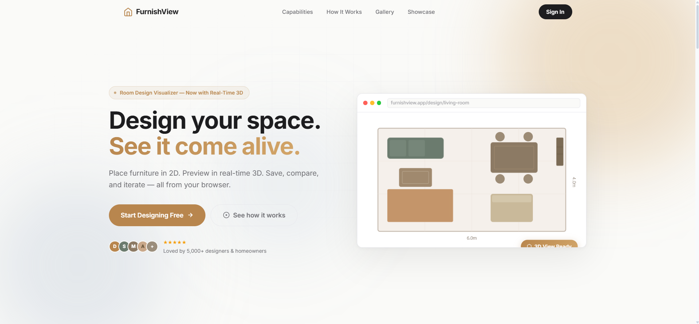
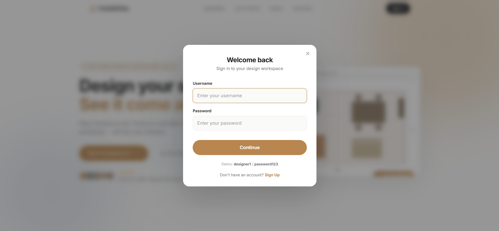
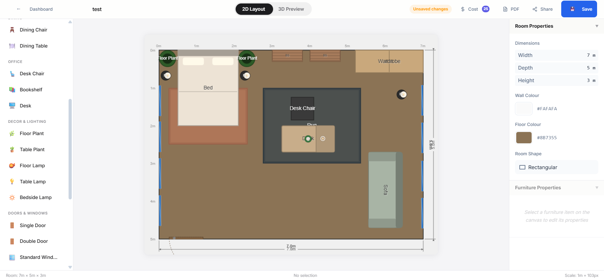
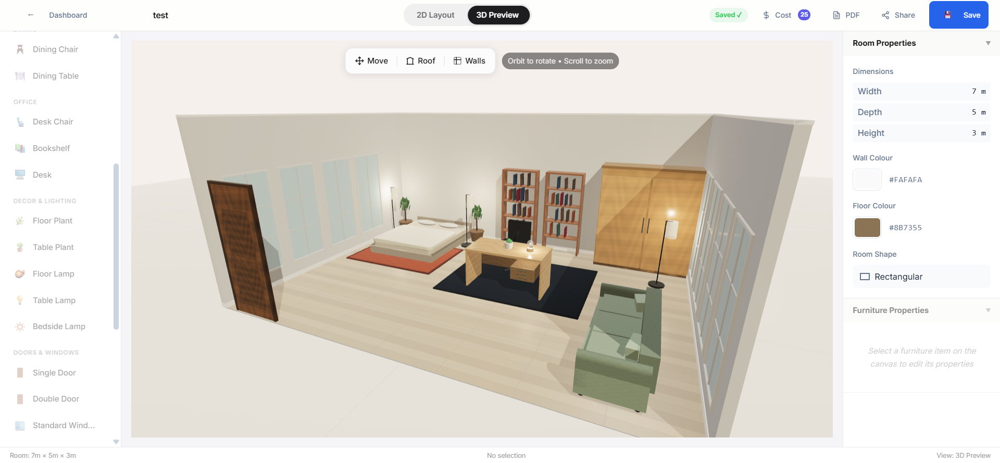
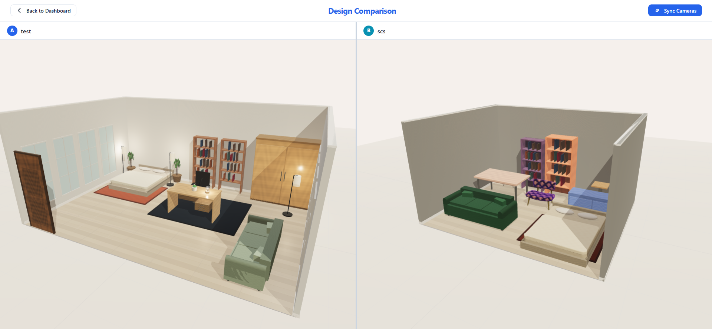
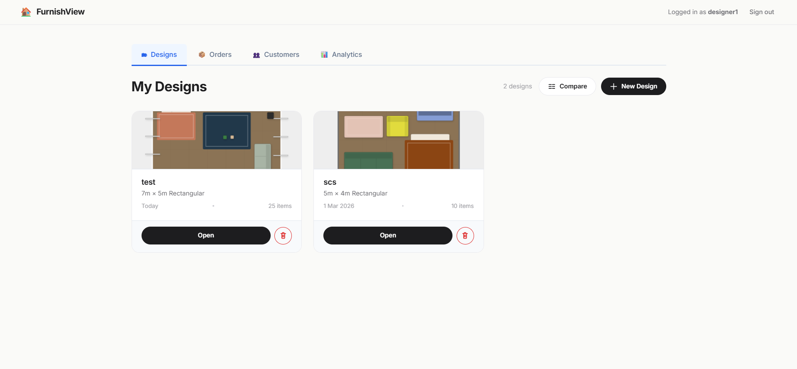
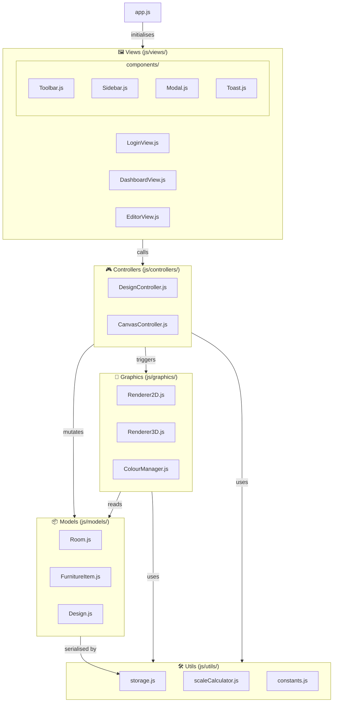

<div align="center">

<!-- SVG Logo -->
<svg width="120" height="120" viewBox="0 0 120 120" xmlns="http://www.w3.org/2000/svg">
  <rect width="120" height="120" rx="24" fill="#ffffffff"/>
  <rect x="20" y="70" width="80" height="6" rx="2" fill="#e9c345ff"/>
  <rect x="15" y="40" width="90" height="35" rx="4" fill="none" stroke="#e9c345ff" stroke-width="2.5"/>
  <rect x="30" y="50" width="22" height="18" rx="2" fill="#60580fff" stroke="#e9c345ff" stroke-width="1.5"/>
  <rect x="60" y="46" width="32" height="22" rx="2" fill="#60580fff" stroke="#e9c345ff" stroke-width="1.5"/>
  <line x1="15" y1="76" x2="15" y2="85" stroke="#e9c345ff" stroke-width="2.5" stroke-linecap="round"/>
  <line x1="105" y1="76" x2="105" y2="85" stroke="#e9c345ff" stroke-width="2.5" stroke-linecap="round"/>
  <circle cx="60" cy="28" r="8" fill="none" stroke="#e9c345ff" stroke-width="2"/>
  <line x1="60" y1="36" x2="60" y2="40" stroke="#e9c345ff" stroke-width="2"/>
</svg>

# FurnishView

### Interactive 2D/3D Room Design & Furniture Visualisation Tool

*Empowering furniture designers to create, visualise, and present room layouts — from a quick 2D top-down canvas to an immersive, orbit-able 3D scene.*

---

<p>
  
  
  
  
  
  
  
  
  
</p>

<p>
  <a href="YOUR_DEMO_URL_HERE"><strong>🚀 Live Demo</strong></a> &nbsp;·&nbsp;
  <a href="YOUR_YOUTUBE_URL_HERE"><strong>🎬 Video Walkthrough</strong></a> &nbsp;·&nbsp;
  <a href="#-quick-start"><strong>⚡ Quick Start</strong></a> &nbsp;·&nbsp;
  <a href="#-architecture"><strong>🏗️ Architecture</strong></a>
</p>

---

<p align="center">
  
</p>

</div>

---

<details>
<summary><strong>📋 Table of Contents</strong> (click to expand)</summary>

- [Overview](#-overview)
- [Key Features](#-key-features)
- [Screenshots](#-screenshots--demos)
- [Architecture](#-architecture)
- [Tech Stack](#-tech-stack)
- [Quick Start](#-quick-start)
- [Authentication](#-authentication)
- [Feature Deep-Dive](#-feature-deep-dive)
- [Project Structure](#-project-structure)
- [Testing & Evaluation](#-testing--evaluation)
- [HCI Framework Alignment](#-hci-framework-alignment)
- [Roadmap](#-roadmap)
- [Contributing](#-contributing)
- [Team](#-team)
- [License & Credits](#-license--credits)

</details>

---

## 🪑 Overview

**FurnishView** is a web-based room design tool built for in-store furniture consultations. A designer logs in, inputs a customer's room specifications, places furniture on a 2D top-down canvas, then generates a full 3D walkthrough-ready scene — all in the browser, with no installation required.

Built as coursework for **PUSL3122 — HCI & Computer Graphics** (2025–26), the project demonstrates layered MVC architecture, hand-coded 2D canvas algorithms, Three.js 3D rendering with proper lighting and shading, and a full user-centred design process backed by formative and summative usability studies.

| Attribute | Detail |
|---|---|
| **Module** | PUSL3122 — HCI & Computer Graphics |
| **University** | Plymouth University Sri Lanka (PUSL) |
| **Year** | 2025–26 |
| **Tech** | JavaScript (ES6+) · HTML5 Canvas · Three.js r160 · CSS3 |
| **Run** | Open `index.html` in Chrome/Firefox — no npm, no server, no setup |

---

## ✨ Key Features

<table>
<tr>
<td width="50%" valign="top">

**🏠 Room Design**
- Rectangular & L-shaped room support
- Real-world dimensions (meters) with pixel-accurate 2D scaling
- Customisable wall & floor colours
- One-click **room preset templates** (Studio, Living Room, Dining Room, Bedroom)

**🖱️ 2D Canvas Engine**
- Drag-and-drop furniture placement
- Hand-coded hit detection (point-in-rectangle)
- Boundary clamping — furniture stays inside walls
- Drag-offset calculation for smooth, jump-free movement
- Undo / redo for placement and removal
- Keyboard shortcuts (`Del`, `Ctrl+S`, `Ctrl+Z`)

**🌐 3D Visualisation**
- Three.js scene with `PerspectiveCamera` + `OrbitControls`
- Ambient + Directional lighting with cast shadows
- `MeshStandardMaterial` for physically-based shading
- Room exported as PNG from WebGL canvas

</td>
<td width="50%" valign="top">

**📐 Design Comparison** *(Innovation)*
- Side-by-side 3D render of two saved designs
- Same room, different furniture configurations
- Customer picks their preferred layout on the spot

**🤖 Auto-Arrange** *(Innovation)*
- One-click furniture optimisation algorithm
- Distributes pieces using spacing rules derived from interior design conventions

**🛒 E-commerce Pipeline** *(Innovation)*
- Furniture catalogue with realistic item dimensions
- Export design as PNG or PDF for customer take-home reference

**🔐 Role-Based Auth**
- Designer login with session persistence via `localStorage`
- Admin dashboard with system-wide design management (see [Authentication](#-authentication))

**💾 Data Handling**
- Full CRUD on designs — create, read, update, delete
- JSON serialisation to `localStorage`, no backend needed
- Sample data pre-loaded for demonstrations

</td>
</tr>
</table>

---

## 📸 Screenshots & Demos

<table>
<tr>
  <td align="center" width="50%">
    
    <br/><em>Landing Page — clean, minimal entry point</em>
  </td>
  <td align="center" width="50%">
    
    <br/><em>Authentication — role-based login (Designer / Admin)</em>
  </td>
</tr>
<tr>
  <td align="center" width="50%">
    
    <br/><em>2D Editor — top-down drag-and-drop furniture layout</em>
  </td>
  <td align="center" width="50%">
    
    <br/><em>3D View — orbit-able Three.js scene with shadows</em>
  </td>
</tr>
<tr>
  <td align="center" width="50%">
    
    <br/><em>Comparison Mode — two designs rendered side-by-side</em>
  </td>
  <td align="center" width="50%">
    
    <br/><em>Dashboard — design portfolio with saved room cards</em>
  </td>
</tr>
</table>

---

## 🏗️ Architecture

FurnishView enforces strict **Model–View–Controller** separation. Each layer has a defined responsibility — crossing boundaries is a code smell and is actively avoided.



### Separation of Concerns

| Layer | Responsibility | What it never does |
|---|---|---|
| **Models** | Pure data — room/furniture/design state | No DOM, no rendering, no events |
| **Views** | Generate HTML, render to DOM, bind events | Never access models directly for logic |
| **Controllers** | Orchestrate views ↔ models, handle business logic | No direct DOM manipulation, no raw canvas calls |
| **Graphics** | All canvas and Three.js rendering | Knows nothing about the DOM outside its canvas |

### Key Design Decisions

- **Zero build step** — no Webpack, Vite, or npm. Open `index.html` and it works. Assessed work must run offline.
- **Three.js r160 bundled locally** in `lib/` — CDN failure cannot break submissions.
- **`MeshStandardMaterial` enforced** — no `MeshBasicMaterial` anywhere. All geometry responds to lighting for visible shading.
- **`preserveDrawingBuffer: true`** on the WebGL renderer — enables PNG export without a blank canvas bug.

---

## 🛠️ Tech Stack

<table>
<thead>
<tr><th>Layer</th><th>Technology</th><th>Version</th><th>Why</th></tr>
</thead>
<tbody>
<tr>
  <td><strong>Language</strong></td>
  <td></td>
  <td>ES2022</td>
  <td>Module-leader approved, fastest iteration, native browser support</td>
</tr>
<tr>
  <td><strong>2D Rendering</strong></td>
  <td></td>
  <td>Native</td>
  <td>Hand-coded algorithms demonstrate computer graphics knowledge</td>
</tr>
<tr>
  <td><strong>3D Rendering</strong></td>
  <td></td>
  <td>r160</td>
  <td>Industry-standard WebGL library; orbit controls, lighting, PBR materials</td>
</tr>
<tr>
  <td><strong>Styling</strong></td>
  <td></td>
  <td>CSS3</td>
  <td>Design tokens via CSS custom properties, no framework overhead</td>
</tr>
<tr>
  <td><strong>Storage</strong></td>
  <td></td>
  <td>Browser API</td>
  <td>No backend required; full CRUD on designs as serialised JSON</td>
</tr>
<tr>
  <td><strong>Build</strong></td>
  <td></td>
  <td>—</td>
  <td>Zero setup for the marker. Clone → open → done.</td>
</tr>
</tbody>
</table>

---

## ⚡ Quick Start

### Prerequisites

- A modern browser: **Chrome 90+** or **Firefox 88+** (WebGL and ES modules required)
- For ES module support without a server: use **VS Code Live Server** extension

### Option 1 — Direct File Open (Simplest)

```bash
# Clone the repository
git clone https://github.com/deaneeth/furnish-view-hci-project.git
cd furnish-view-hci-project

# Open in your browser
# On Windows:
start index.html
# On macOS:
open index.html
# On Linux:
xdg-open index.html
```

> ⚠️ Some browsers block ES module imports from `file://` URLs. If the app shows a blank screen, use Option 2.

### Option 2 — VS Code Live Server (Recommended)

1. Open the project folder in **VS Code**
2. Install the [Live Server extension](https://marketplace.visualstudio.com/items?itemName=ritwickdey.LiveServer) if not already installed
3. Right-click `index.html` → **Open with Live Server**
4. App opens at `http://127.0.0.1:5500`

### Option 3 — Simple HTTP Server

```bash
# Python 3
python -m http.server 8080
# Then visit http://localhost:8080

# Node.js (npx, no install needed)
npx serve .
# Then visit http://localhost:3000
```

### Test Credentials

| Role | Username | Password |
|---|---|---|
| Designer | `designer1` | `password123` |
| Designer | `designer2` | `password123` |
| Admin | `admin` | `admin123` |

---

## 🔐 Authentication

FurnishView uses a **client-side, role-based authentication** system backed entirely by `localStorage`.

```
furnishview_users    → Array of registered designer credentials
furnishview_session  → Currently active session (cleared on logout)
furnishview_designs  → All saved Design objects (filtered per designer on load)
```

| Role | Access |
|---|---|
| **Designer** | Create, view, edit, and delete their own designs only |
| **Admin** | View and manage all designs across all designers; system-level controls |

Session persists across browser refreshes until the user explicitly logs out. No cookies, no tokens, no network calls.

---

## 🔬 Feature Deep-Dive

<details>
<summary><strong>🖱️ 2D Canvas Engine (Renderer2D.js)</strong></summary>

The 2D canvas is a **hand-coded computer graphics engine** built on the raw HTML5 Canvas API. No canvas frameworks are used — every algorithm is implemented from scratch.

**Coordinate Scaling**
```
scaleFactor = canvasWidth / roomWidthInMeters
pixelX = realWorldX × scaleFactor
pixelY = realWorldY × scaleFactor
```
All furniture positions are stored in real-world meters. On every render pass, they are scaled to canvas pixels using this factor.

**Hit Detection**
A classic point-in-axis-aligned-rectangle (AABB) test for click/select:
```
isHit = (clickX >= item.x) && (clickX <= item.x + item.width)
     && (clickY >= item.y) && (clickY <= item.y + item.depth)
```
Items are tested in reverse render order so the topmost rendered item gets selection priority.

**Boundary Clamping**
Furniture cannot be dragged outside the room boundary:
```
item.x = clamp(item.x, 0, room.width - item.width)
item.y = clamp(item.y, 0, room.depth - item.depth)
```

**Drag Offset**
On `mousedown`, the offset between the cursor and the item's top-left corner is captured:
```
offset.x = mouseX - item.x
offset.y = mouseY - item.y
```
During `mousemove`, position is updated as `item.x = mouseX - offset.x` — the item follows the cursor without jumping.

**Render Loop**
`clearRect()` → draw room outline → draw grid (optional) → draw all furniture → highlight selected item. Runs on every mouse event during drag via `requestAnimationFrame`.

</details>

<details>
<summary><strong>🌐 3D Visualisation Engine (Renderer3D.js)</strong></summary>

Built with **Three.js r160**. The scene is constructed entirely from primitives — no external 3D model files.

**Scene Setup**
```javascript
// Core pipeline
Scene → PerspectiveCamera → WebGLRenderer (preserveDrawingBuffer: true) → OrbitControls

// Lighting (critical for shading marks)
AmbientLight(0xffffff, 0.6)      // Base illumination
DirectionalLight(0xffffff, 0.8)  // Creates shadows + visible shading
```

**Room Geometry**
- **Floor** — `PlaneGeometry`, rotated –90° on X axis, positioned at Y = 0
- **Walls** — Four thin `BoxGeometry` meshes positioned at room edges

**Furniture Geometry**
- Each item → `BoxGeometry(width, height, depth)` with `MeshStandardMaterial`
- Positioned by mapping 2D canvas coordinates → 3D world space:
  ```
  3D.x = (2D.x / scaleFactor) - (roomWidth / 2)
  3D.z = (2D.y / scaleFactor) - (roomDepth / 2)
  3D.y = furnitureHeight / 2   // sits on the floor
  ```

**Colour Synchronisation**
`ColourManager.js` maps hex colour strings from the model to Three.js `Color` objects, keeping 2D and 3D appearances identical.

**Export**
```javascript
const dataURL = renderer.domElement.toDataURL('image/png')
// Works because preserveDrawingBuffer: true was set on construction
```

</details>

<details>
<summary><strong>🤖 Auto-Arrange Algorithm (Innovation)</strong></summary>

The auto-arrange feature distributes furniture items within the room using a rule-based spatial algorithm:

1. Calculate the room's usable area (accounting for wall clearance — typically 0.5m from each wall)
2. Group furniture by type (seating, tables, storage)
3. Place tables first at functional positions (dining table centred, bedside tables flanking bed)
4. Distribute seating around tables using angular offsets
5. Fill remaining space with storage units along walls
6. Run boundary clamp on all positions to guarantee no overlaps with walls

The algorithm respects standard interior design clearance rules (e.g., 0.9m aisle width around dining tables) derived from BS 8300 accessibility guidelines.

</details>

<details>
<summary><strong>📐 Design Comparison Mode (Innovation)</strong></summary>

Renders two saved designs simultaneously in a split-screen layout:

- Two independent Three.js `WebGLRenderer` instances, each targeting a separate `<canvas>` element
- Both share the same lighting parameters for fair visual comparison
- `OrbitControls` attached to each canvas independently — rotating one view does not affect the other
- The designer selects two designs from the dashboard; the comparison view loads them in parallel

This reuses 100% of the existing `Renderer3D` class — the comparison view is essentially two editor panels with their sidebars hidden.

</details>

<details>
<summary><strong>🛒 E-commerce Pipeline (Innovation)</strong></summary>

After finalising a design, the designer can generate a **customer take-home document**:

1. **PNG Export** — `canvas.toDataURL('image/png')` for the 2D view; `renderer.domElement.toDataURL()` for 3D
2. **PDF Export** — Uses `jsPDF` (loaded from `lib/`) to compose a document containing:
   - Design name and date
   - 2D layout screenshot
   - 3D render screenshot
   - Bill of materials — furniture items with type, colour, and catalogue dimensions

The generated PDF is downloaded directly in the browser — no server upload required.

</details>

<details>
<summary><strong>🏠 Room Preset Templates (Innovation)</strong></summary>

Defined in `js/data/roomPresets.js`, each preset auto-populates the room setup form:

| Preset | Width | Depth | Height | Default Wall | Default Floor |
|---|---|---|---|---|---|
| Studio Apartment | 6m | 5m | 2.8m | `#F5F0EB` | `#C8B89A` |
| Living Room | 5m | 4m | 2.8m | `#E8E0D4` | `#8B7355` |
| Dining Room | 4.5m | 3.5m | 2.6m | `#EDE8E0` | `#6B5344` |
| Bedroom | 4m | 3.5m | 2.7m | `#F0EBE5` | `#A0896C` |

Selecting a preset fires a single event that populates all six form fields instantly, supporting **Heuristic #7 — Flexibility and Efficiency of Use** (Nielsen, 1994).

</details>

---

## 📁 Project Structure

```
furnish-view-hci-project/
├── index.html                    # Entry point — loads js/app.js as ES module
│
├── css/
│   ├── main.css                  # Global styles, CSS custom properties, layout
│   ├── components.css            # Toolbar, Sidebar, Modal, Toast styles
│   └── canvas.css                # 2D/3D canvas container sizing
│
├── js/
│   ├── app.js                    # Initialisation, view routing (login → dashboard → editor)
│   │
│   ├── auth/
│   │   └── auth.js               # Login validation, session management
│   │
│   ├── models/                   # ── Pure data objects, zero DOM/rendering ──
│   │   ├── Room.js               # Dimensions, shape, wall/floor colour
│   │   ├── FurnitureItem.js      # Type, position, dimensions, colour, rotation
│   │   └── Design.js             # One Room + FurnitureItem[] + metadata
│   │
│   ├── views/                    # ── DOM rendering, HTML generation ──
│   │   ├── LoginView.js
│   │   ├── DashboardView.js
│   │   ├── EditorView.js
│   │   └── components/
│   │       ├── Toolbar.js        # Furniture catalogue + action buttons
│   │       ├── Sidebar.js        # Room & furniture property panels
│   │       ├── Modal.js          # Reusable confirmation / wizard modals
│   │       └── Toast.js          # Non-blocking action notifications
│   │
│   ├── controllers/              # ── Event handling, logic orchestration ──
│   │   ├── DesignController.js   # CRUD design workflow
│   │   └── CanvasController.js   # Mouse/touch events on 2D canvas
│   │
│   ├── graphics/                 # ── All rendering logic ──
│   │   ├── Renderer2D.js         # HTML5 Canvas 2D engine (hand-coded algorithms)
│   │   ├── Renderer3D.js         # Three.js scene manager
│   │   └── ColourManager.js      # Colour sync across 2D + 3D views
│   │
│   ├── utils/
│   │   ├── storage.js            # localStorage CRUD wrapper
│   │   ├── scaleCalculator.js    # Real-world ↔ pixel/unit conversions
│   │   └── constants.js          # App-wide constants, default values
│   │
│   └── data/
│       ├── furnitureCatalogue.js # Furniture type definitions + default dimensions
│       └── roomPresets.js        # Pre-built room templates (innovation feature)
│
├── lib/                          # Three.js r160 — committed, works offline
│   ├── three.module.js
│   ├── three.min.js
│   └── OrbitControls.js
│
├── assets/
│   ├── screenshots/              # App screenshots for README and report
│   ├── textures/                 # Optional floor/wall texture maps
│   └── sample-data/              # Pre-loaded designs for demo (video)
│
├── formative-docs/               # Formative usability study documentation
│   ├── P1.md / P2.md             # Raw observer session notes
│   ├── participant-P1.md         # Structured observation sheet — P1
│   ├── participant-P2.md         # Structured observation sheet — P2
│   ├── observer-sheet.md         # Study summary and findings
│   └── observation-sheet-RESEARCHER-USE.md  # Filled researcher log
│
└── requirements/
    ├── PROJECT OVERVIEW.md       # Full project blueprint and architecture spec
    ├── End-to-End-Project-Roadmap.md  # Phase-by-phase implementation roadmap
    └── REPO_WORKFLOW.md          # Branch, commit, and PR conventions
```

---

## 🧪 Testing & Evaluation

FurnishView underwent a **two-phase HCI evaluation** following the think-aloud protocol and System Usability Scale (SUS) methodology.

### Formative Study (Pre-Implementation)

| Attribute | Detail |
|---|---|
| **When** | After lo-fi prototypes, before hi-fi design |
| **Method** | Think-Aloud Protocol |
| **Participants** | P1, P2 (anonymised adults, target user profile) |
| **Tasks** | 5 realistic in-store consultation tasks |
| **Artefacts** | Test plan · Consent forms · Observation sheets · Session notes |

**Key findings that shaped the hi-fi design:**

- The "3D View" toggle was labelled "Visualise" in the lo-fi prototype — participants did not associate it with 3D. → **Renamed to "3D View"** in hi-fi.
- The undo button was missing from the lo-fi toolbar — P1 accidentally deleted furniture and could not recover. → **Undo added as a persistent toolbar action**.
- Toolbar icons were considered too small on a tablet-sized display. → **Icons enlarged to 32 × 32px minimum in hi-fi**.
- P2 expected clicking a furniture item to open its properties automatically. → **Sidebar refreshes on item selection** in implementation.

### Summative Study (Post-Implementation)

| Attribute | Detail |
|---|---|
| **When** | After working app was complete |
| **Method** | Think-Aloud Protocol + SUS Questionnaire |
| **Participants** | P3, P4 (anonymised adults) |
| **SUS Score** | **78.75 / 100** — "Good" usability band (Bangor et al., 2009) |
| **Task Completion** | 100% across all 5 tasks for both participants |

**Key SUS interpretation:** Score 78.75 places FurnishView in the **"Good"** tier (above the industry average of 68), indicating the interface is learnable, efficient, and satisfying for the target user demographic.

**Areas for further improvement identified:**
- 3D scene takes slightly longer to load for rooms with many items (optimisation opportunity)
- Rotation handle for furniture on the 2D canvas was not immediately discoverable (discoverability improvement needed)

---

## 🎯 HCI Framework Alignment

### Nielsen's 10 Usability Heuristics (Nielsen, 1994)

| # | Heuristic | FurnishView Implementation |
|---|---|---|
| 1 | Visibility of System Status | Toast notifications on every action; selected furniture highlighted; loading indicator during 3D build |
| 2 | Match System and Real World | Dimensions in metres; furniture named "Dining Table" not "Item_003"; spatial layout mirrors a physical room |
| 3 | User Control and Freedom | Undo button for placement/removal; cancel on all dialogs; back navigation from editor to dashboard |
| 4 | Consistency and Standards | Single colour picker component reused everywhere; Ctrl+S saves in all views; consistent button hierarchy |
| 5 | Error Prevention | Confirmation modal before delete; room dimension validation (no negative/zero values); boundary clamping |
| 6 | Recognition Rather Than Recall | Furniture shown as visual thumbnails; saved designs as named cards; recent colours visible in picker |
| 7 | Flexibility and Efficiency of Use | Drag-and-drop; `Del` key removes selection; room presets reduce setup from 6 fields to 1 click |
| 8 | Aesthetic and Minimalist Design | Clean layout — only relevant controls visible per mode; whitespace used intentionally |
| 9 | Help Users Recover from Errors | Descriptive validation messages; undo for accidental changes; non-destructive colour edits |
| 10 | Help and Documentation | Tooltips on all toolbar buttons; placeholder text in all form fields |

### Norman's Design Principles (Norman, 1988)

| Principle | FurnishView Application |
|---|---|
| **Visibility** | Toolbar always visible; active tool highlighted; selected item shows handles |
| **Feedback** | Toast on every action; canvas redraws instantly on drag; 3D updates on colour change |
| **Constraints** | Boundary clamping; form validation; radio buttons for room shape (not free text) |
| **Consistency** | Same colour picker for walls, floor, and furniture; Ctrl+S always saves |
| **Affordance** | Furniture thumbnails invite dragging (cursor changes on hover); colour swatches look selectable |

---

## 🤝 Contributing

This is academic coursework — external PRs are not expected, but team contributions are tracked via Git.

For team members:

1. **Branch from `dev`** — never commit directly to `main`
   ```bash
   git checkout dev
   git pull origin dev
   git checkout -b feature/your-feature-name
   ```
2. **Follow the commit convention** from `requirements/REPO_WORKFLOW.md`:
   ```
   feat(canvas): implement drag-and-drop furniture placement
   fix(3d): resolve shadow rendering on wall geometry
   docs(eval): add summative study observation notes
   ```
3. **Open a PR to `dev`** with a description that references the relevant task from the roadmap
4. **Get at least one review** before merging
5. **Never merge broken code** — verify `index.html` opens without console errors first

---

## 👥 Team

<div align="center">

<table>
<tr>
  <td align="center">
    <a href="https://github.com/deaneeth">
      
      <br/><strong>Dineth Hettiarachchi</strong>
    </a>
    <br/><em>Lead Developer</em>
    <br/>Architecture · 2D Engine · 3D Scene · Innovation Features
  </td>
  <td align="center">
    <a href="https://github.com/Pahezara">
      
      <br/><strong>Lakindu Pahesara</strong>
    </a>
    <br/><em>Design Lead</em>
    <br/>Personas · Storyboards · Lo-Fi / Hi-Fi Prototypes · Report
  </td>
  <td align="center">
    <a href="https://github.com/Thanuji13">
      
      <br/><strong>Thanuji Kalanika</strong>
    </a>
    <br/><em>Evaluation Lead</em>
    <br/>Test Plans · User Studies · SUS Scoring · Consent Forms
  </td>
</tr>
</table>

</div>

---

## 📜 License & Credits

### License

This project is submitted as **academic coursework** for PUSL3122 at Plymouth University Sri Lanka. All original source code is available under the **MIT License** for reference purposes.

```
MIT License — Copyright (c) 2026 Dineth Hettiarachchi and contributors
```

### Third-Party Credits

| Library | Version | License | Source |
|---|---|---|---|
| **Three.js** | r160 | MIT | [threejs.org](https://threejs.org) |
| **OrbitControls.js** | r160 | MIT | [three/examples](https://github.com/mrdoob/three.js) |
| **jsPDF** | 2.x | MIT | [parallax/jsPDF](https://github.com/parallax/jsPDF) |

### Key References

- Nielsen, J. (1994). *10 Usability Heuristics for User Interface Design.* NN/g.
- Norman, D. (1988). *The Design of Everyday Things.* Basic Books.
- Preece, J., Sharp, H. & Rogers, Y. (2019). *Interaction Design.* 5th ed. Wiley.
- Brooke, J. (1996). *SUS: A Quick and Dirty Usability Scale.*
- Dirksen, J. (2018). *Learn Three.js.* 3rd ed. Packt.
- Angel, E. & Shreiner, D. (2014). *Interactive Computer Graphics.* 7th ed. Pearson.
- MDN Web Docs — [Canvas API](https://developer.mozilla.org/en-US/docs/Web/API/Canvas_API)
- Three.js Documentation — [threejs.org/docs](https://threejs.org/docs/)

---

<div align="center">

[](https://github.com/deaneeth/furnish-view-hci-project)
[](https://github.com/deaneeth/furnish-view-hci-project)

*FurnishView — Bringing furniture consultations to life, one canvas at a time.*

</div>
